# Kotoba 言葉

Free, open-source app for learning Japanese on Android 8.0+ (made on GrapheneOS, Pixel 8 Pro).
Short lessons introduce new things; spaced-repetition reviews bring them back right before you'd forget them.

<p>
  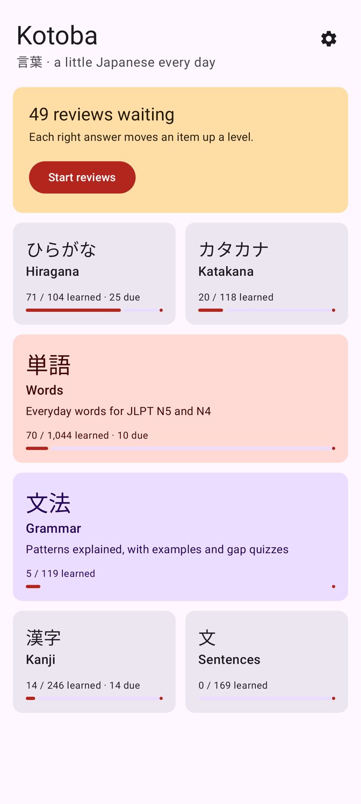
  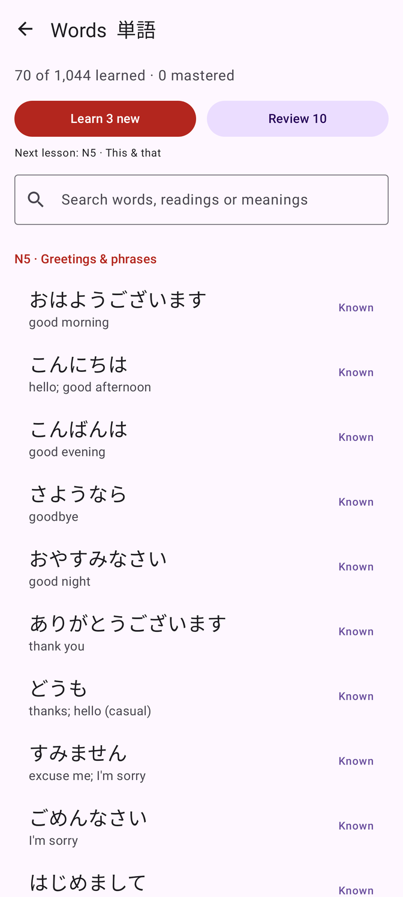
  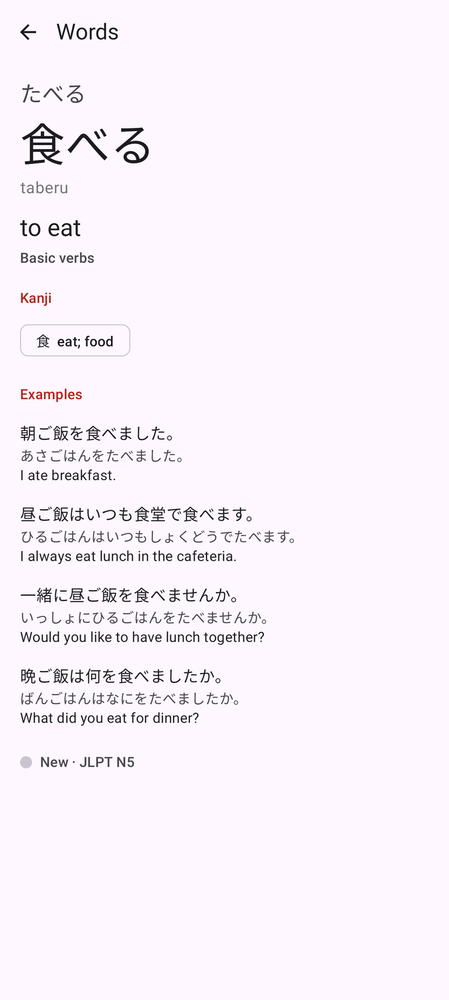
  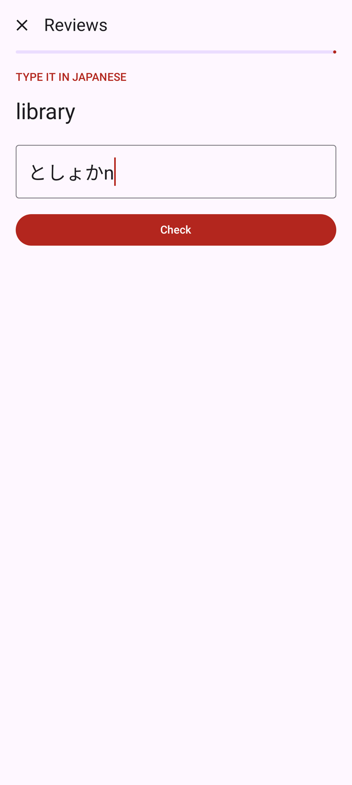
</p>
<p>
  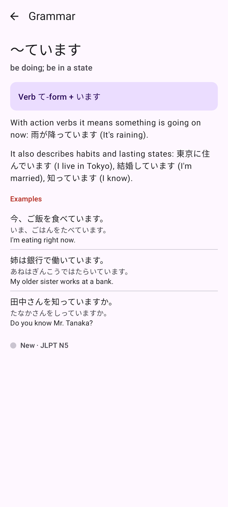
  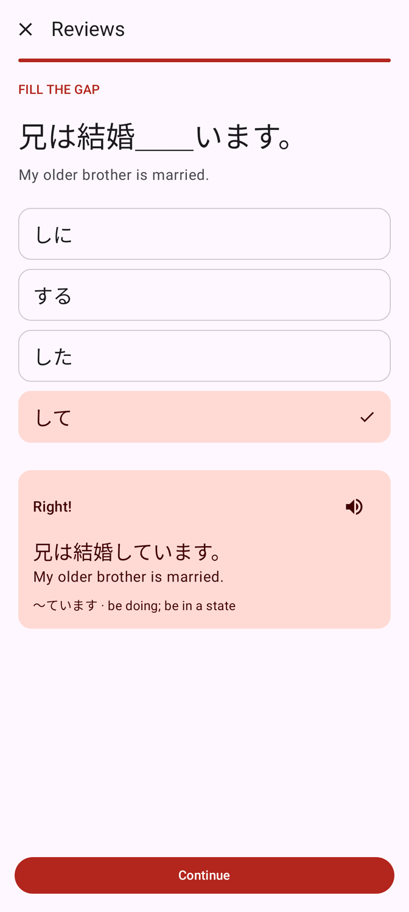
  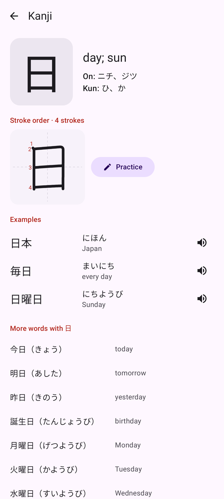
  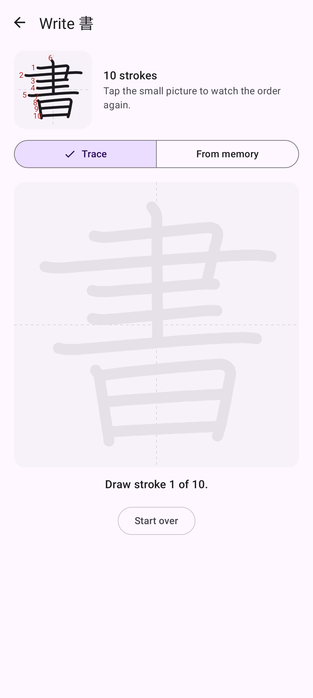
</p>
<p>
  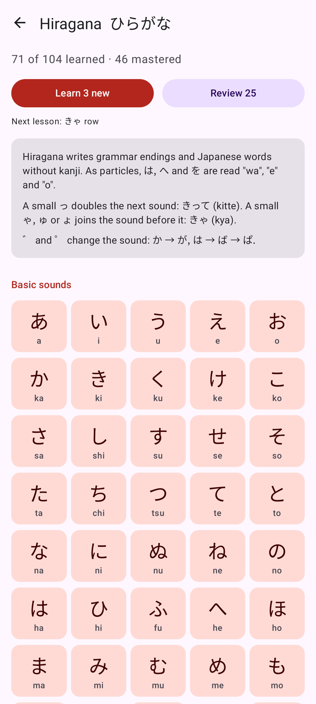
  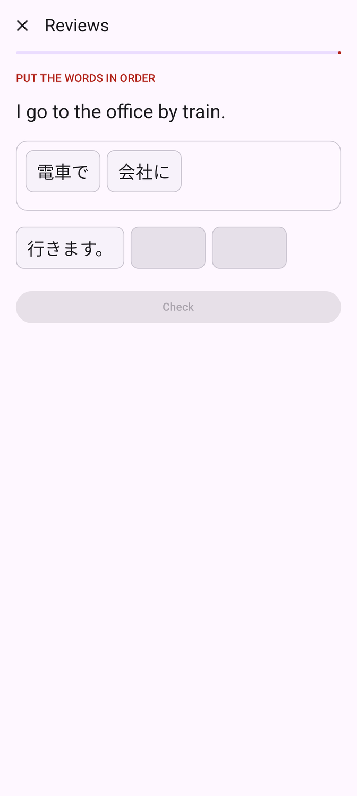
  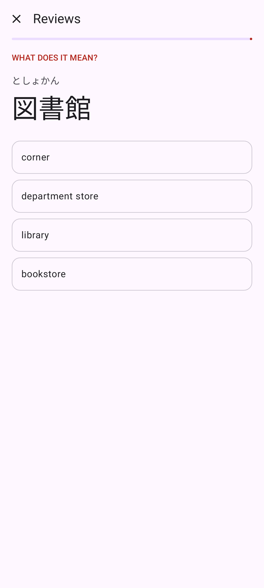
  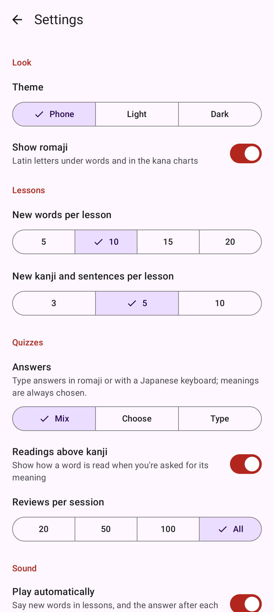
</p>

## What's inside

| Section | Content |
| --- | --- |
| **Words** | 1,044 everyday words for JLPT N5 and N4, in topics (greetings, food, verbs, ...), with readings, romaji, their kanji and example sentences |
| **Grammar** | 119 grammar points (63 N5, 56 N4), each with a plain-English explanation, the pattern, three examples and gap-fill questions |
| **Hiragana** | The full chart: 46 basic sounds, ゛/゜ sounds and combinations like きゃ |
| **Katakana** | The same, plus sounds for foreign words like ファ and ティ |
| **Kanji** | 246 kanji (N5 and N4) with meanings, on and kun readings, example words and every word in the app that uses them |
| **Sentences** | 169 everyday sentences with readings, in situations like shopping, travel and asking for help |

## How it works

- **Learn**: each section has lessons of a few new items from one topic (by default 10 words, 5 kanji, one grammar point or one kana row). You read the cards, then do a short quiz.
- **Review**: everything you've learned comes back for review after 4 hours, then 8 hours, 1 day, 2 days, 4 days, a week, 2 weeks, a month and 4 months. A wrong answer moves an item back two steps and asks it again at the end of the session.
- **Questions** change each time: meaning ↔ Japanese, reading a kanji word, filling the gap in a grammar sentence, or putting a sentence back in the right order.
- **Typing**: answers can be typed instead of chosen. Type romaji (`taberu`) and it turns into kana (たべる) as you go, so no Japanese keyboard is needed; a Japanese keyboard works too.
- **Stroke order**: every kana and kanji page shows the character being written stroke by stroke. **Practice** lets you write it with your finger, tracing or from memory; each stroke is checked for shape, position and direction.
- **Audio**: every kana, word, kanji example, sentence and grammar example can be played, with natural pitch accent (箸 and 橋 sound different). The clips are in the app, so this works offline.
- **Backup**: on first start Kotoba asks for a folder and then saves your progress there as `kotoba-progress.txt` after every lesson and review, so you can back it up however you like (Syncthing, a computer, a USB stick). Pick the same folder after a reinstall or on a new phone and Kotoba offers to restore it. No storage permission is needed: you choose the folder in Android's own file picker.
- **Settings**: theme, lesson sizes, choose/type/mix answers, romaji on or off, readings above kanji in quizzes, reviews per session, sound on or off, the backup folder, and resetting progress.
- Kanji are always drawn with Japanese glyphs, even on a phone set to English or German.

## Privacy

- No internet permission, no permissions at all, no Google code, no ads, no tracking.
- Your progress is one small file on your phone, copied to the backup folder you chose (if you chose one). Android backup (Seedvault on GrapheneOS) can include it too.

## Install

1. Download `Kotoba-<version>.apk` from [Releases](https://github.com/RealKHFan/kotoba/releases).
2. Open it on your phone and allow installing from your browser or file manager.

Check that the APK is the real one: its signing certificate SHA-256 is

```
47:63:0C:6E:6F:32:DF:26:90:DC:D2:B9:BD:FB:A4:51:2F:E0:7E:09:C4:5E:48:E8:7D:0A:AE:10:3B:55:16:8B
```

(`apksigner verify --print-certs Kotoba-<version>.apk`, or the AppVerifier app.)

## Build

Kotlin + Jetpack Compose, no other libraries.

```
./gradlew testDebugUnitTest      # logic tests, plus a check that every content file parses
./gradlew recordRoborazziDebug   # screenshots of the main screens in app/src/test/screenshots
./gradlew assembleRelease        # set KOTOBA_KEYSTORE, KOTOBA_KEYSTORE_PASSWORD, KOTOBA_KEY_ALIAS to sign
```

The learning content is plain text in `app/src/main/assets` (one line per word, kanji or sentence; one block per grammar point), so fixes and additions are easy to make.
After changing it, rebuild the generated files:

```
python3 tools/strokes.py /path/to/kanjivg     # stroke order, from a KanjiVG checkout
python3 tools/audio.py --only-missing         # sound clips for new or changed text (needs style-bert-vits2 and ffmpeg)
python3 tools/audio.py --only-missing --recheck  # also remake clips a speech recognizer can't make out (needs faster-whisper)
```

## Credits

The words, sentences, grammar notes and quizzes were written for Kotoba. Readings were checked against
[JMdict and KANJIDIC2](https://www.edrdg.org/) and the [MeCab](https://taku910.github.io/mecab/) tokenizer with UniDic; none of that data ships in the app.

- Stroke order: [KanjiVG](https://kanjivg.tagaini.net) by Ulrich Apel and contributors, [CC BY-SA 3.0](https://creativecommons.org/licenses/by-sa/3.0/). Converted to point lists for Kotoba (`app/src/main/assets/strokes.txt`, same license).
- Voice: words and sentences made with [Style-Bert-VITS2](https://github.com/litagin02/Style-Bert-VITS2) and the [JVNV M2 voice model](https://huggingface.co/litagin/style_bert_vits2_jvnv) (trained on the JVNV corpus), [CC BY-SA 4.0](https://creativecommons.org/licenses/by-sa/4.0/); single kana made with [Open JTalk](https://open-jtalk.sourceforge.net/) and its HTS voice (Modified BSD). The clips in `app/src/main/assets/audio` are under CC BY-SA 4.0.
- Icon: the character 言 from Noto Serif CJK JP (SIL Open Font License).

## License

[GPL-3.0](LICENSE)
